English ｜ [繁體中文](README.md)

# AI for All

**Watch one video, and know you've actually learned it.**

A free, nonprofit platform for learning AI. We turn YouTube creators' tutorials into structured courses, each followed by a short quiz — so you know right away whether you understood it and where you went wrong, while your progress and completion badges are saved for you.

<p align="center">
  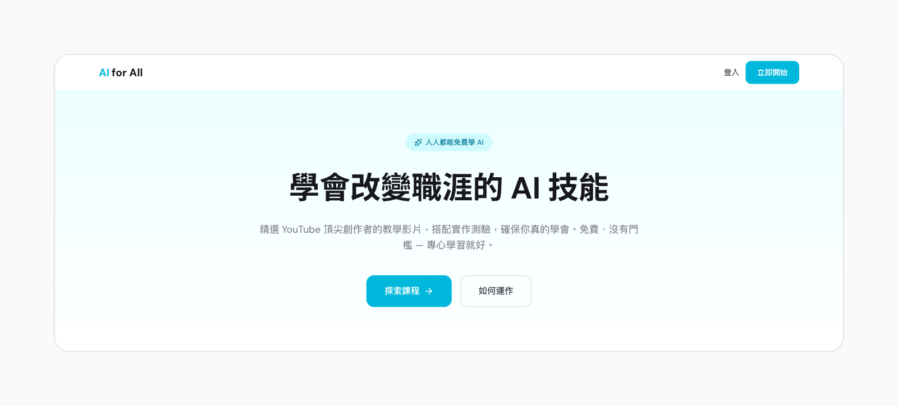
</p>

> All screens below use demo data. Courses, names and numbers are for illustration only and are not real operating figures. The interface is in Traditional Chinese.

## The learner's journey

### 1. Find a course

<p align="center">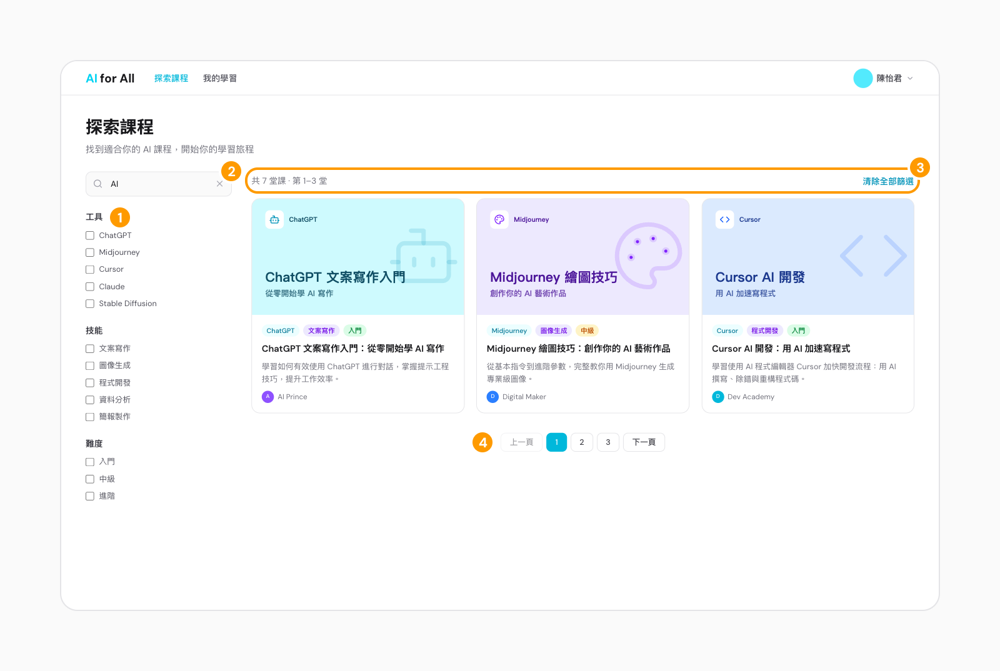</p>

1. Filter by tool, skill and difficulty — the three combine.
2. Keyword search matches both titles and descriptions.
3. The result count is always visible, with one click to clear every filter.
4. 20 courses per page, with page numbers.

### 2. Watch the creator's video on the platform

<p align="center">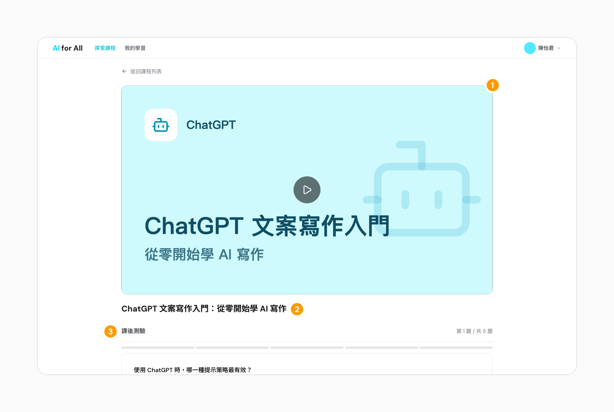</p>

1. The creator's YouTube video is embedded, so every play counts toward their channel.
2. The title says exactly what the course teaches.
3. The quiz sits right below the video — watch, then answer.

### 3. Answer right after watching

<p align="center">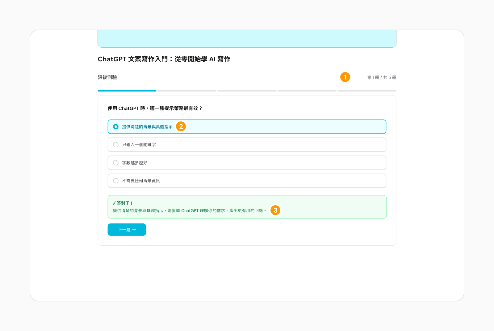</p>

1. One question at a time, with clear progress.
2. After you submit, the question and your answer stay on screen for reference.
3. You're told immediately whether you were right and why, including the correct answer if not. Short answers are graded by AI against a sample answer, by meaning — in Chinese or English.

### 4. Complete the course, earn the badge

<p align="center">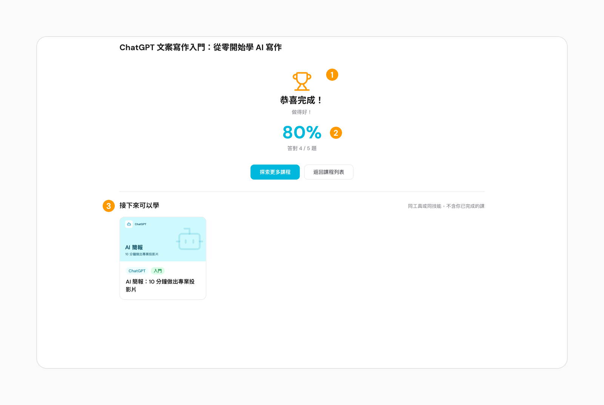</p>

1. Score 60% or more to complete the course and earn its badge.
2. The score is based on correct answers.
3. Recommendations: courses on the same tool or skill that you haven't taken.

### 5. Didn't pass? Try again

<p align="center">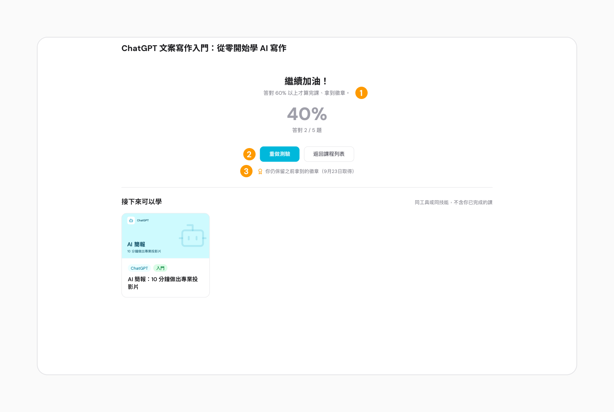</p>

1. Below 60% doesn't count as completed — the page encourages you and never says "failed".
2. Retake the quiz any time.
3. Badges you've already earned are never taken away.

### 6. Track your progress

<p align="center">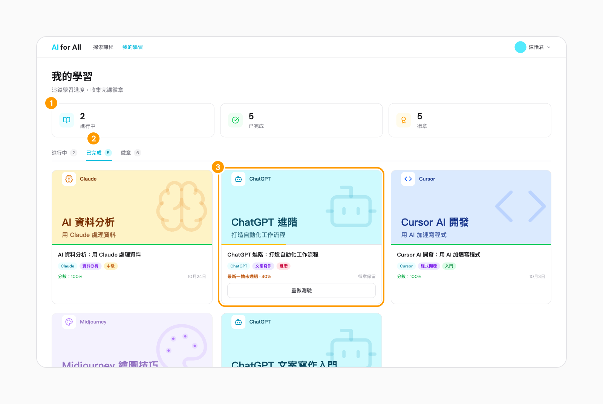</p>

1. In-progress, completed and badge counts at a glance.
2. Three tabs list your courses; "Continue" picks up at your first unanswered question.
3. A retake that didn't pass stays in Completed, marked "latest round not passed", and keeps its badge.

## The operator's journey

> Admin screens also use demo data; the numbers are not real operating figures.

### 7. See the platform at a glance

<p align="center">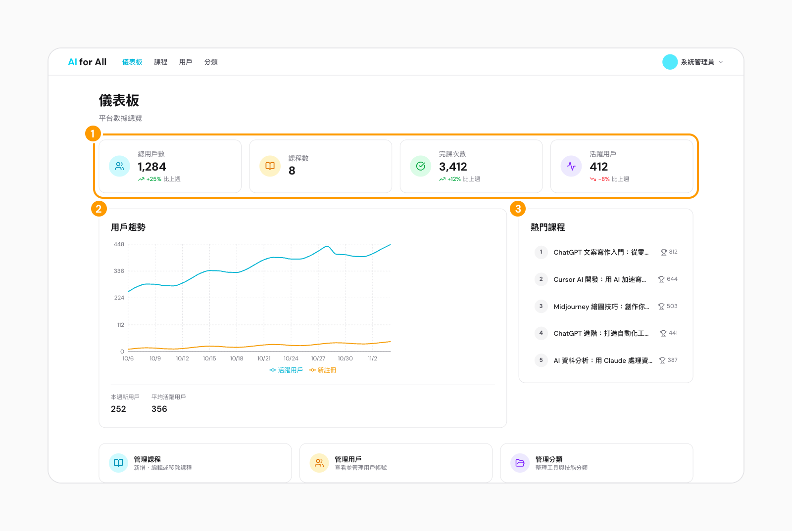</p>

1. Total users, courses, completions and active users, each compared with last week.
2. Daily active users and new sign-ups over the last 30 days.
3. The 5 most-completed courses.

### 8. Manage courses

<p align="center">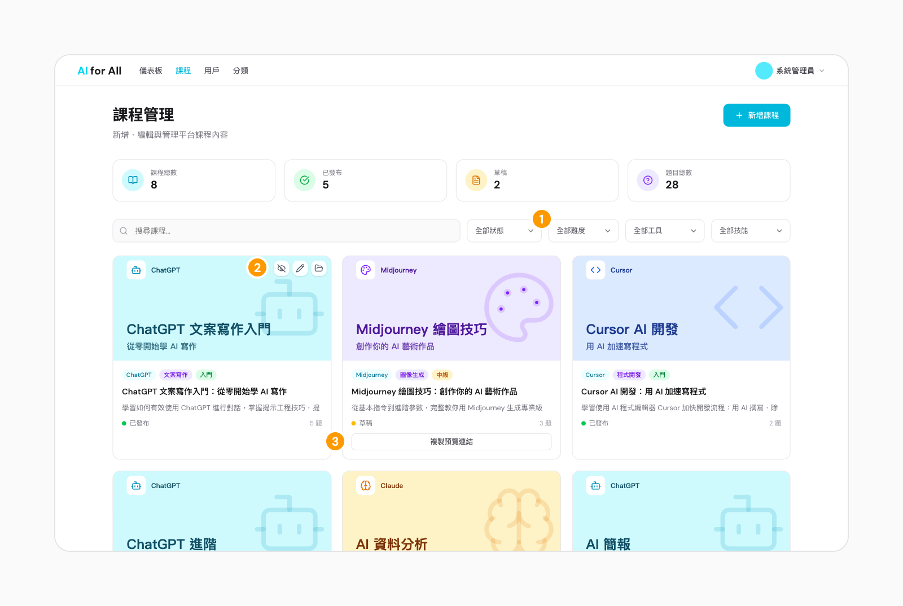</p>

1. Filter by status (draft / published / archived), difficulty, tool and skill.
2. Publish or unpublish, edit and archive right from the card; archiving keeps learners' records.
3. Drafts can share a preview link, valid until the course is published.

### 9. Write questions

<p align="center">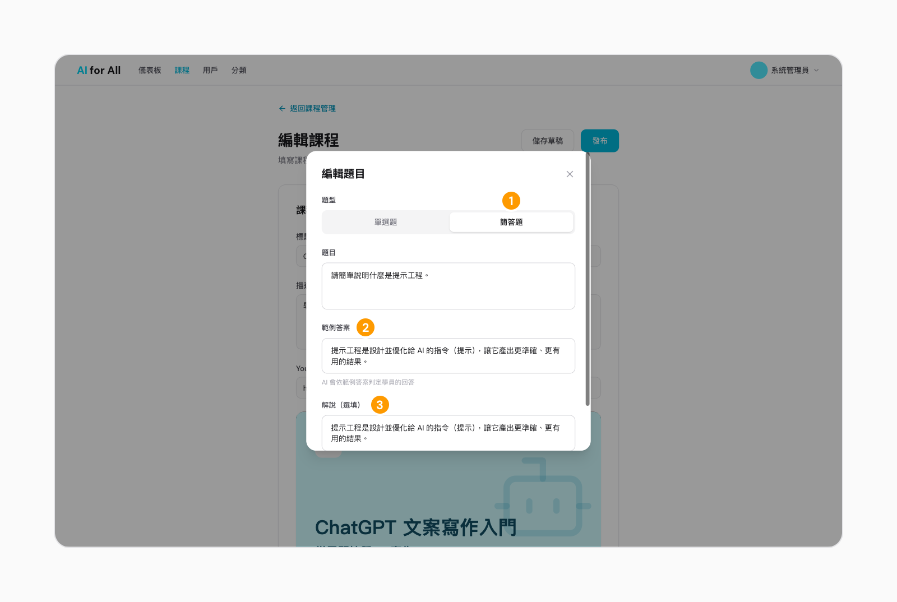</p>

1. Multiple choice or short answer.
2. Short answers need a sample answer — the AI grades learners against it.
3. The explanation is shown after the learner submits.

### 10. Look at one learner's progress

<p align="center">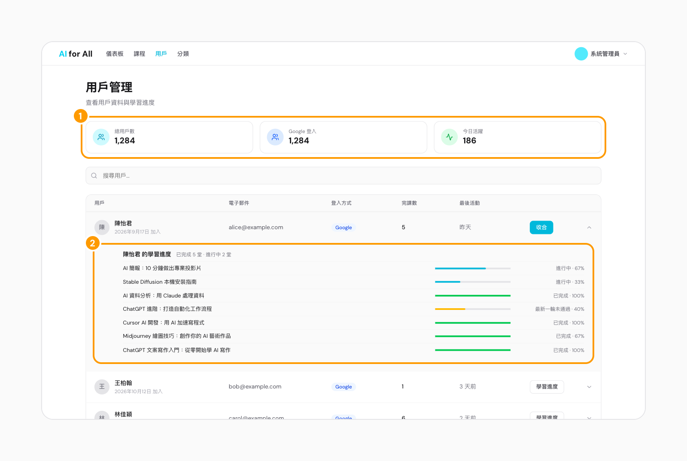</p>

1. Total users, sign-in method and today's active users.
2. Expand any learner to see their progress and score in every course.

## Operating model

Learners pay nothing, so every party has to get more than they put in for this to work.

| Who | Gives | Gets |
|---|---|---|
| Learners | Time to watch and answer; a Google sign-in to save progress | No hunting for courses; instant feedback on what they understood; saved progress and badges |
| YouTube creators | Permission to embed their public tutorials | Plays count toward their channel, from viewers who finish and answer — people who really want to learn |
| The platform (nonprofit) | Curating, writing questions and explanations, maintaining categories, plus hosting and staff time | Completions and accuracy that show the work is worth doing |

**Principles**

- **Free for learners**: courses, quizzes, explanations and badges cost nothing.
- **Content belongs to creators**: we only embed YouTube videos — no downloading or re-uploading — and get the creator's consent before a course goes live.
- **Ranking isn't for sale**: courses are listed newest first, in the order they were added. No paid placement, no leaderboard; scores are visible only to the learner and admins.
- **Learn first, sign in later**: anyone can watch and answer; signing in is only needed to see results and save progress.

**Revenue (planned)**: team / enterprise plans paid by companies. Certificates will be free, with criteria to be decided.

## Technical details

### Stack

| Layer | Technology |
|---|---|
| Frontend | Next.js 16 (App Router), React 19, TypeScript, Tailwind CSS v4, shadcn/ui (Base UI), TanStack Query, Zustand, Zod, Recharts, Lucide |
| Backend | Go 1.25, Gin, sqlc + pgx, golang-migrate, OAuth2 (Google) + JWT, Anthropic Go SDK (AI grading for short answers) |
| Infrastructure | PostgreSQL 16, Redis 7, Docker Compose, Prometheus + Grafana, GitHub Actions |

The backend uses a three-layer architecture: Handler → Service → Repository. Services define interfaces and repositories implement them, so each layer can be tested on its own.

### Architecture

```
┌────────────────────────────────────────────────┐
│                 Docker Compose                  │
│                                                 │
│  Next.js frontend (3000) ──▶ Go API (8080, Gin + sqlc) │
│                             │          │        │
│                     PostgreSQL (5432)  Redis (6379)│
│                                                 │
│  Optional --profile monitoring: Prometheus (9090) + Grafana (3001) │
└────────────────────────────────────────────────┘
```

### Engineering highlights

- **Three layers with dependency inversion**: Handler → Service → Repository. Services define interfaces; repositories implement them with type-safe code that sqlc generates from SQL, so unit tests swap the database for mocks.
- **Data consistency**: a course and its questions (added, edited, deleted, reordered) are saved in one transaction, with the question-order unique constraint checked at commit. Schema changes are versioned with golang-migrate.
- **AI grading for short answers**: the backend calls Claude through the Anthropic Go SDK to judge the learner's meaning against a sample answer, with a timeout, one retry and a server-side fallback model. If grading fails, the request returns an error instead of marking the answer wrong.
- **Auth and security**: Google OAuth2 sign-in with JWT access tokens; the refresh token lives in an HttpOnly cookie scoped to `/api/v1/auth` and is rotated on every refresh. CORS is configured, and per-IP rate limiting counts requests in Redis.
- **Observability**: Prometheus records request counts, latency and in-flight requests for every HTTP call, with a provisioned Grafana dashboard; structured logging with Zap, and every request carries an `X-Request-ID`.
- **Testing**: Go unit tests (mock repositories), integration tests (testcontainers-go with a real PostgreSQL), Vitest component tests and Playwright E2E.
- **CI and code quality**: GitHub Actions runs ESLint, type checks, Prettier, tests and coverage for the frontend; go vet, golangci-lint, a Swagger docs check, tests and coverage for the backend; then verifies the Docker images build. Integration and E2E tests currently run locally and are not in CI yet. husky + lint-staged check every commit.
- **Containers**: one Docker Compose command starts the frontend, backend, PostgreSQL and Redis; the backend uses a multi-stage build for a slim production image, and monitoring is opt-in through a profile.

<p align="center">
  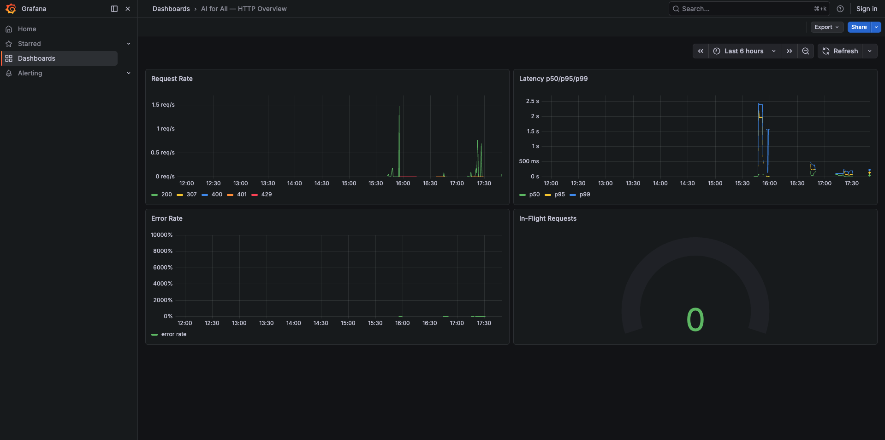
  <br><em>Grafana dashboard: request rate, p50/p95/p99 latency, error rate and in-flight requests</em>
</p>

### Why this stack

- **Next.js**: the most complete React ecosystem (shadcn/ui, TanStack Query and Zustand all live there) with first-class TypeScript; if course pages need SEO later, they can move to server-side rendering.
- **Go**: goroutines handle many concurrent connections, it compiles to a single binary with a small image, and dependency management is stable; Anthropic ships an official Go SDK, so AI grading needs no separate Python service. The trade-off: different languages on each side, so types aren't shared.

### Getting started

```bash
git clone https://github.com/rocker15962/AIForAllFullStack.git
cd AIForAllFullStack
cp .env.example .env       # add Google OAuth credentials; AI grading needs ANTHROPIC_API_KEY

make dev                   # frontend, backend, PostgreSQL, Redis (or make dev-detach)
make migrate               # run database migrations
make seed                  # load demo data
make health                # should show "status": "ok"

make admin EMAIL=you@gmail.com   # sign in once via OAuth, then promote yourself
make monitoring                  # optional: Prometheus + Grafana
```

- Frontend: <http://localhost:3000>
- Backend health: <http://localhost:8080/api/v1/health>
- API docs (Swagger): <http://localhost:8080/swagger/index.html>
- All environment variables: [`docs/ENVIRONMENT.md`](docs/ENVIRONMENT.md)

### Project structure

```
AIForAllFullStack/
├── frontend/          # Next.js (app/ routes, components/, lib/, stores/, e2e/)
├── backend/           # Go API (cmd/server, internal/{handler,service,repository,middleware}, db/{migrations,queries,seed.sql})
├── monitoring/        # Prometheus + Grafana config
├── docs/              # Technical docs and screenshots
├── docker-compose.yml
├── Makefile
└── PRODUCT_ROADMAP.md
```

### API

All endpoints live under `/api/v1/`:

| Domain | What it covers |
|---|---|
| Auth | Google OAuth2 sign-in, refresh token, sign-out, current user |
| Courses | List and detail, recommendations, progress, start, submit answers (AI-graded short answers), complete, retake |
| Categories | Tools, skills, creators |
| User | My progress, completed courses, badges, stats, profile, avatar |
| Admin | Dashboard; course, user and category management |

### Testing

| Type | Tool | Command |
|---|---|---|
| Backend unit | Go `testing` | `cd backend && go test ./...` |
| Backend integration | testcontainers-go + PostgreSQL | `cd backend && go test -tags integration ./internal/integration/ -v` |
| Frontend unit | Vitest + React Testing Library | `cd frontend && npx vitest run` |
| Frontend E2E | Playwright | `cd frontend && npx playwright test` |

Integration tests start PostgreSQL in Docker by default; without Docker, point `TEST_DATABASE_URL` at an empty PostgreSQL database.

### Roadmap

Next up: AI-personalised learning paths, creator self-service publishing, enterprise plans and certificates, and Kubernetes deployment. See [`PRODUCT_ROADMAP.md`](PRODUCT_ROADMAP.md).
