[English](README.en.md) ｜ 繁體中文

# AI for All

**讓想學 AI 的人，看完一支影片，就知道自己真的學會了。**

免費、非營利的 AI 學習平台。我們把 YouTube 創作者的教學影片整理成一堂堂課，每堂課後面接幾題小測驗：答完立刻知道懂不懂、錯在哪，學習進度和完課徽章也都幫你記著。

<p align="center">
  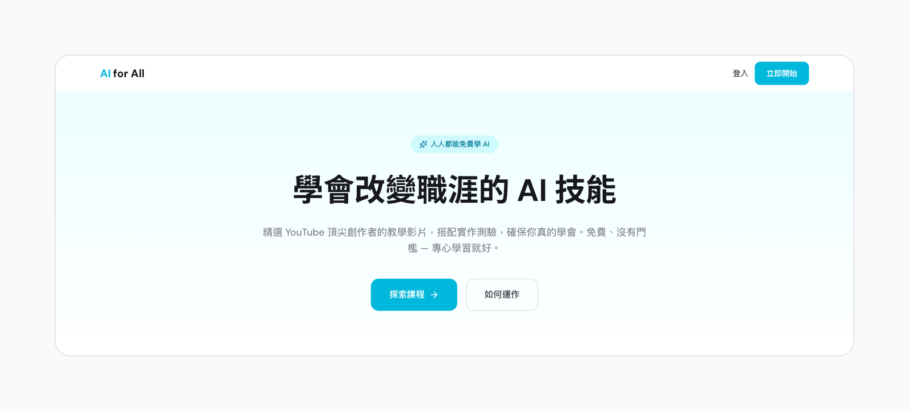
</p>

> 以下畫面都是示範資料：課程、人名與數字只用來說明功能，不代表實際的營運數據。

## 學員的旅程

### 1. 找到想上的課

<p align="center">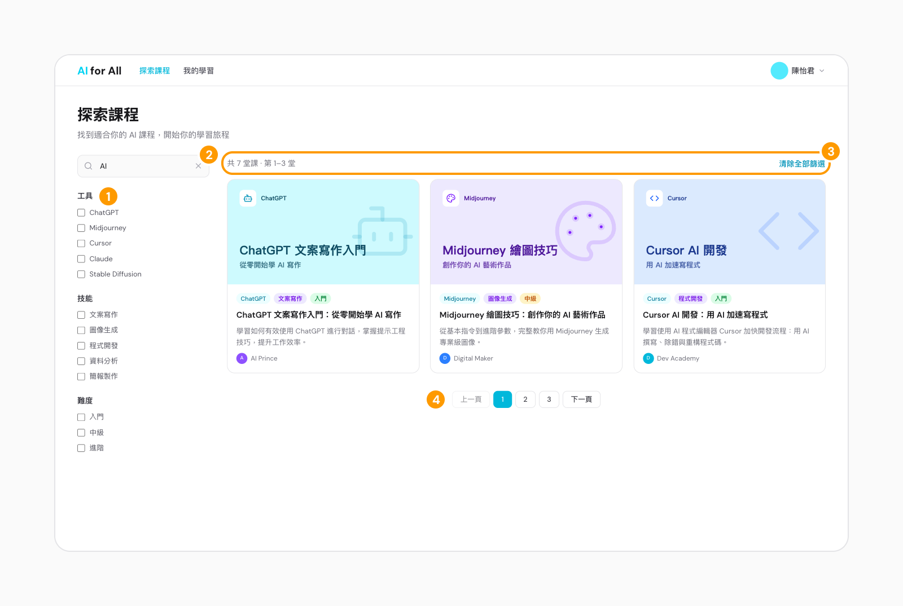</p>

1. 依工具、技能、難度篩選，三組條件可以疊加。
2. 關鍵字搜尋，同時比對課名與描述。
3. 隨時看得到結果數量，也能一次清除全部篩選。
4. 每頁 20 堂課，用頁碼翻頁。

### 2. 在站內看創作者的影片

<p align="center">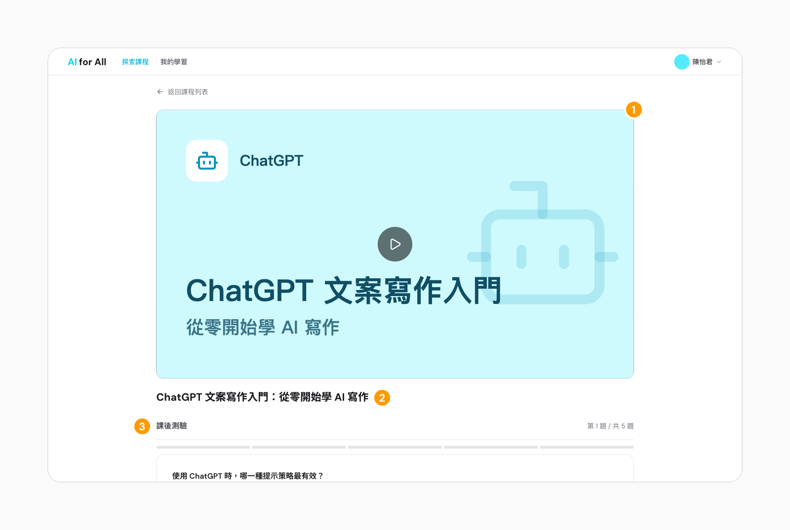</p>

1. 直接嵌入創作者的 YouTube 影片，播放次數都算在創作者的頻道。
2. 課名清楚寫出這堂課在教什麼。
3. 影片下方就是課後測驗，看完直接作答。

### 3. 看完接著作答

<p align="center">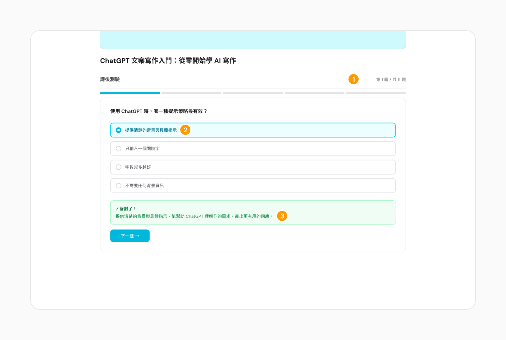</p>

1. 一次一題，隨時知道是第幾題、還剩幾題。
2. 送出後，題目和你選的答案都留在畫面上，方便對照。
3. 立刻告訴你對錯和原因，答錯也會給正確答案。簡答題由 AI 依範例答案判斷意思，中英文作答都可以。

### 4. 完課、拿到徽章

<p align="center">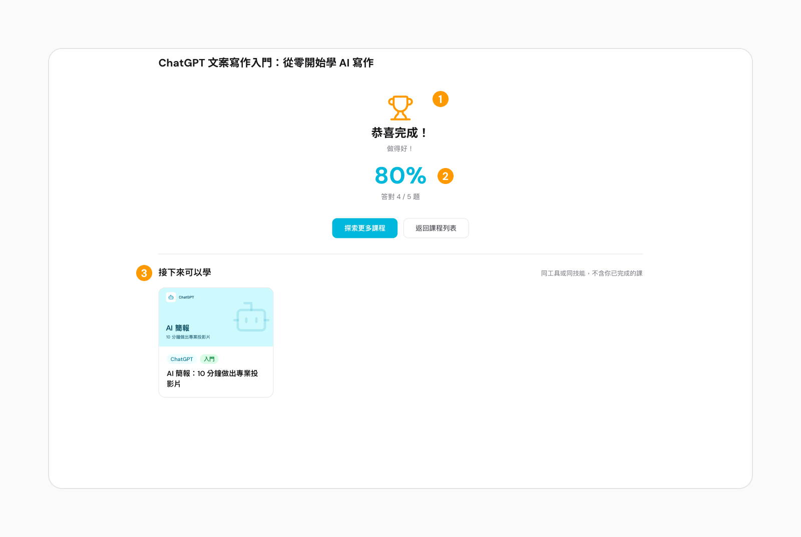</p>

1. 答對 60% 以上就算完課，拿到這堂課的徽章。
2. 分數依答對的題數計算。
3. 推薦同工具或同技能、你還沒上過的課。

### 5. 沒過也能重來

<p align="center">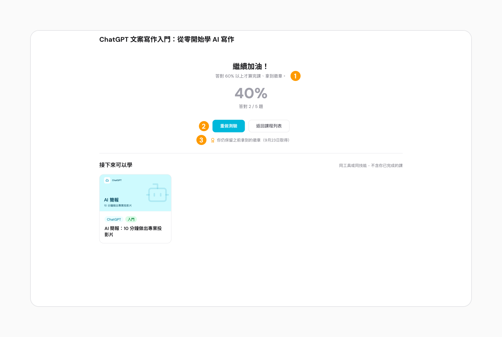</p>

1. 沒到 60% 不算完課，畫面只鼓勵，不寫「不及格」。
2. 隨時可以重做測驗。
3. 之前拿到的徽章不會收回。

### 6. 追蹤自己的進度

<p align="center">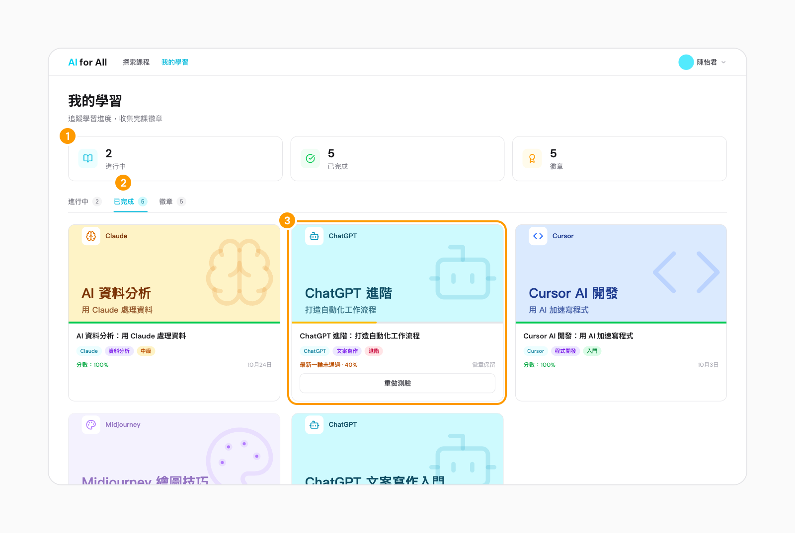</p>

1. 進行中、已完成和徽章的數量一目了然。
2. 三個分頁分別列出課程；「繼續學習」會從還沒作答的題目接著做。
3. 重做沒過的課留在「已完成」，標示「最新一輪未通過」，徽章照樣保留。

## 營運方的旅程

> 後台畫面同樣是示範資料，數字不代表實際的營運數據。

### 7. 一眼看懂平台狀況

<p align="center">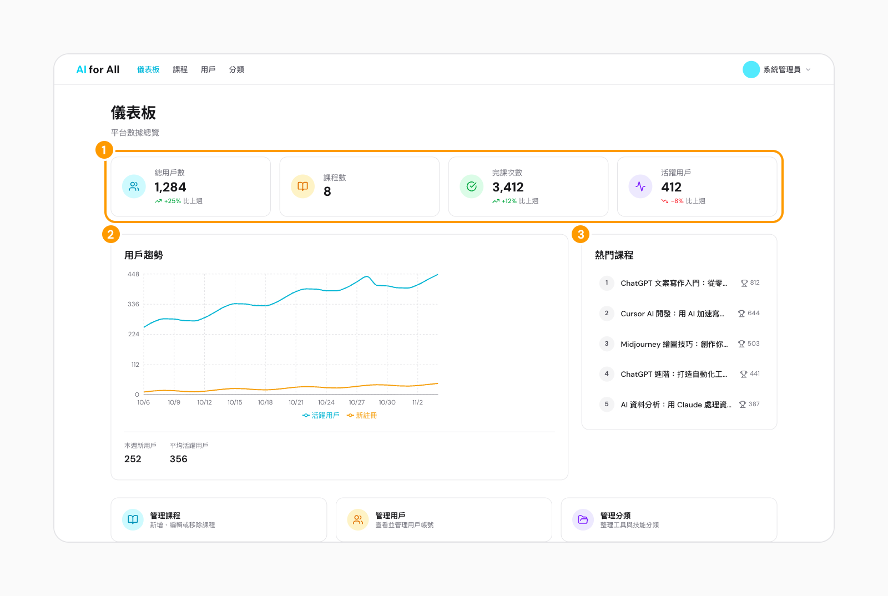</p>

1. 總用戶、課程、完課與活躍用戶，附上跟上週比的變化。
2. 最近 30 天的每日活躍與新註冊趨勢。
3. 完課數最高的 5 堂課。

### 8. 管理課程上架

<p align="center">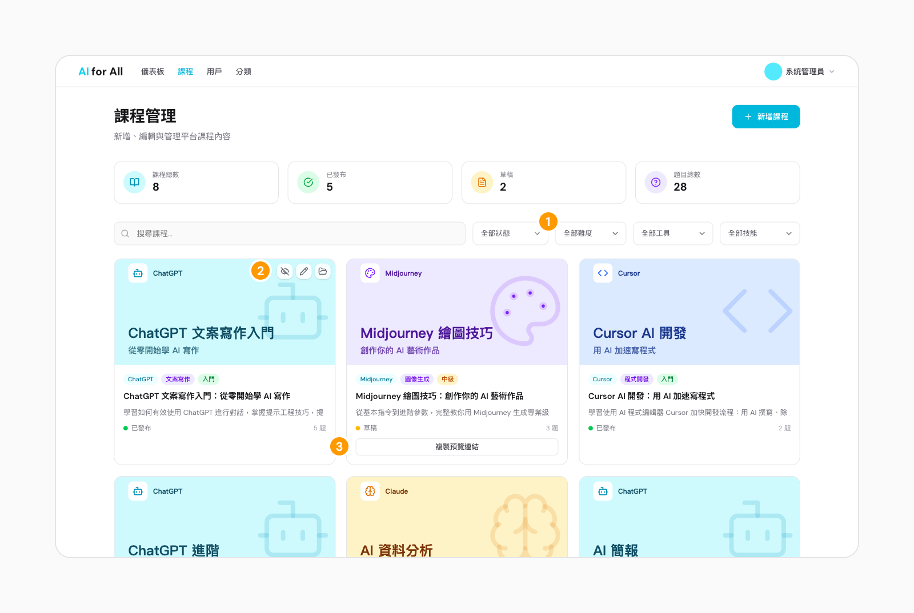</p>

1. 依狀態（草稿／已發布／已封存）、難度、工具、技能篩選。
2. 在卡片上直接發布或取消發布、編輯、封存；封存的課會保留學員的學習紀錄。
3. 草稿可以複製預覽連結給別人看，課程發布前都有效。

### 9. 出題

<p align="center">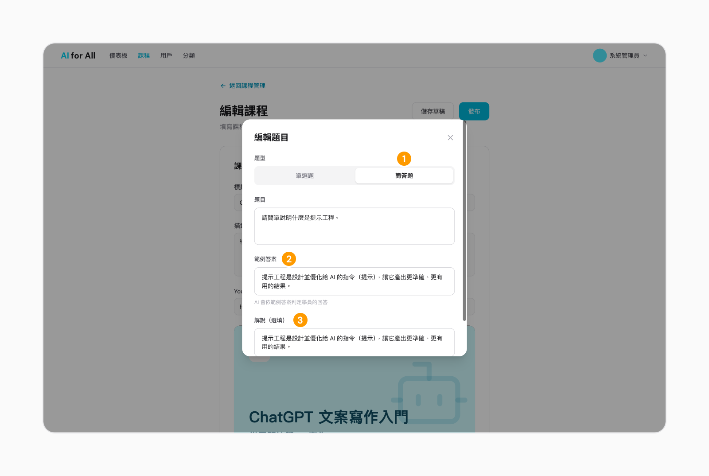</p>

1. 可以出單選題或簡答題。
2. 簡答題要填範例答案，AI 依它判斷學員的回答。
3. 解說會在學員送出答案後顯示。

### 10. 看單一學員的學習情況

<p align="center">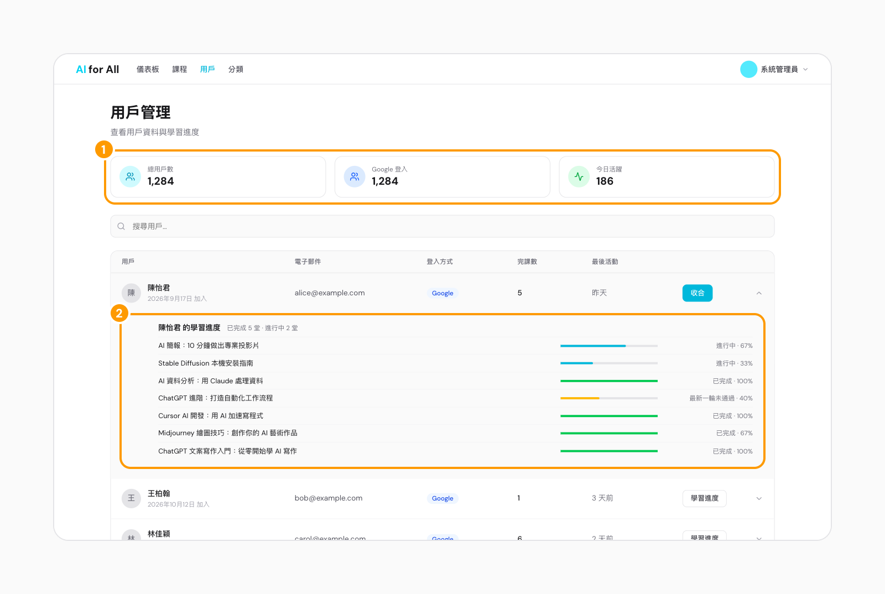</p>

1. 總用戶、登入方式與今日活躍人數。
2. 展開任一位學員，就能看到他每堂課的進度與分數。

## 營運模式

學員完全免費，所以每一方得到的都要比付出的多，這件事才走得下去。

| 誰 | 付出 | 得到 |
|---|---|---|
| 學員 | 看影片、答題的時間；想保存進度時，用 Google 帳號登入 | 不用自己找課；答完就知道懂不懂、錯在哪；進度和徽章幫你記著 |
| YouTube 創作者 | 同意平台嵌入公開的教學影片 | 播放次數都算在自己的頻道，遇到的是看完還會作答、真的想學的觀眾 |
| 平台（非營利） | 選片、出題、寫解說、維護分類，以及主機與人力 | 用完課數和答對率，證明這件事值得做 |

**我們的原則**

- **學員免費**：看課、作答、解說、徽章都不收費。
- **內容屬於創作者**：只嵌入 YouTube 影片，不下載、不重新上傳；課程上架前，先取得創作者同意。
- **排序不賣**：課程依加入平台的先後排序（新的在前），不做付費推薦，也不做排行榜；分數只有學員自己和管理員看得到。
- **先讓人學，再請人登入**：不登入也能看影片、作答；想看對錯、保存進度時才需要登入。

**收入來源（規劃中）**：向企業收費的企業／團隊方案。證書會免費提供，發放條件之後再定。

## 技術細節

### 技術棧

| 層 | 技術 |
|---|---|
| 前端 | Next.js 16（App Router）、React 19、TypeScript、Tailwind CSS v4、shadcn/ui（Base UI）、TanStack Query、Zustand、Zod、Recharts、Lucide |
| 後端 | Go 1.25、Gin、sqlc ＋ pgx、golang-migrate、OAuth2（Google）＋ JWT、Anthropic Go SDK（簡答題 AI 判定） |
| 基礎設施 | PostgreSQL 16、Redis 7、Docker Compose、Prometheus ＋ Grafana、GitHub Actions |

後端採用 Handler → Service → Repository 三層架構。Service 定義介面、Repository 實作，所以每一層都能獨立測試。

### 架構

```
Next.js 前端（:3000）
  └─▶ Go API（:8080，Gin ＋ sqlc）
        ├─▶ PostgreSQL（:5432）
        ├─▶ Redis（:6379，限流）
        └─▶ Claude API（簡答題 AI 判定，外部服務）

選用 --profile monitoring：
  Prometheus（:9090）抓取 Go API 的 /metrics ─▶ Grafana（:3001）
```

除了 Claude API，其他服務都由 Docker Compose 啟動。

### 工程亮點

- **三層架構與依賴反轉**：Handler → Service → Repository。Service 定義介面，Repository 用 sqlc 從 SQL 產生型別安全的程式碼來實作；單元測試用 mock 取代資料庫。
- **資料一致性**：課程和題目（新增、修改、刪除、排序）在同一個 transaction 裡儲存，題目順序的唯一約束延到 commit 才檢查。資料表變更用 golang-migrate 管理版本。
- **AI 判定簡答題**：後端用 Anthropic Go SDK 呼叫 Claude，依範例答案判斷學員的意思；設有逾時、重試一次和伺服器端備援模型。判定失敗時回報錯誤，不會把學員的答案記成答錯。
- **驗證與安全**：Google OAuth2 登入，access token 用 JWT；refresh token 放在 HttpOnly cookie，只送往 `/api/v1/auth`，每次換發都會輪替。另有 CORS 設定，以及用 Redis 計數的 IP 限流。
- **可觀測性**：Prometheus 記錄每個 HTTP 請求的次數、延遲和處理中的請求數，Grafana 儀表板自動佈建；Zap 結構化日誌，每個請求都帶 `X-Request-ID`。
- **測試**：Go 單元測試（mock repository）、整合測試（testcontainers-go 啟動真的 PostgreSQL）、Vitest 元件測試、Playwright E2E。
- **CI 與程式品質**：GitHub Actions 檢查前端的 ESLint、型別、Prettier、測試與覆蓋率，後端的 go vet、golangci-lint、Swagger 文件、測試與覆蓋率，最後驗證 Docker 映像能建置。整合測試與 E2E 目前在本機執行，還沒放進 CI。commit 前由 husky ＋ lint-staged 自動檢查。
- **容器化**：Docker Compose 一個指令啟動前端、後端、PostgreSQL、Redis；後端用多階段建置產出精簡的正式版映像，監控服務用 profile 選擇性啟動。

<p align="center">
  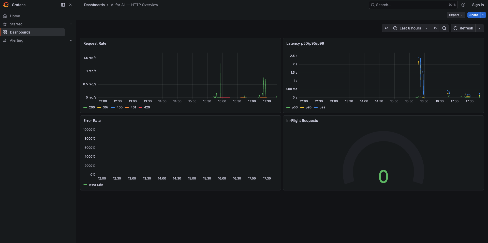
  <br><em>Grafana 儀表板：請求速率、延遲 p50／p95／p99、錯誤率與處理中的請求</em>
</p>

### 選型理由

- **Next.js**：React 生態系最完整（shadcn/ui、TanStack Query、Zustand 都在這個生態系），TypeScript 支援完整；課程頁之後如果要做 SEO，可以直接改成伺服器端渲染。
- **Go**：goroutine 適合大量同時連線，編譯成單一執行檔、映像檔小，依賴管理穩定；Anthropic 有官方 Go SDK，所以 AI 判定不需要另外架 Python 服務。取捨是前後端語言不同，型別不能共用。

### 快速開始

```bash
git clone https://github.com/rocker15962/AIForAllFullStack.git
cd AIForAllFullStack
cp .env.example .env       # 填入 Google OAuth 憑證；簡答題 AI 判定需要 ANTHROPIC_API_KEY

make dev                   # 啟動前端、後端、PostgreSQL、Redis（背景執行用 make dev-detach）
make migrate               # 執行資料庫 migration
make seed                  # 載入示範資料
make health                # 應看到 "status": "ok"

make admin EMAIL=you@gmail.com   # 先用 OAuth 登入一次，再把自己設成管理員
make monitoring                  # 選用：加上 Prometheus ＋ Grafana
```

- 前端：<http://localhost:3000>
- 後端健康檢查：<http://localhost:8080/api/v1/health>
- API 文件（Swagger）：<http://localhost:8080/swagger/index.html>
- 所有環境變數見 [`docs/ENVIRONMENT.md`](docs/ENVIRONMENT.md)

### 專案結構

```
AIForAllFullStack/
├── frontend/          # Next.js 前端（app/ 路由、components/、lib/、stores/、e2e/）
├── backend/           # Go API（cmd/server、internal/{handler,service,repository,middleware}、db/{migrations,queries,seed.sql}）
├── monitoring/        # Prometheus ＋ Grafana 設定
├── docs/              # 技術文件與截圖
├── docker-compose.yml
├── Makefile
└── PRODUCT_ROADMAP.md
```

### API

所有端點都在 `/api/v1/` 底下：

| 領域 | 說明 |
|---|---|
| Auth | Google OAuth2 登入、refresh token、登出、目前使用者 |
| Courses | 課程列表與詳情、推薦、進度、開始、送出答案（簡答題 AI 判定）、完課、重做 |
| Categories | 工具、技能、創作者列表 |
| User | 我的進度、已完成、徽章、統計、個人資料、大頭貼 |
| Admin | 儀表板，課程、用戶、分類管理 |

### 測試

| 類型 | 工具 | 指令 |
|---|---|---|
| 後端單元測試 | Go `testing` | `cd backend && go test ./...` |
| 後端整合測試 | testcontainers-go ＋ PostgreSQL | `cd backend && go test -tags integration ./internal/integration/ -v` |
| 前端單元測試 | Vitest ＋ React Testing Library | `cd frontend && npx vitest run` |
| 前端 E2E | Playwright | `cd frontend && npx playwright test` |

整合測試預設用 Docker 啟動 PostgreSQL；沒有 Docker 時，可以把 `TEST_DATABASE_URL` 指向一個空的 PostgreSQL 資料庫。

### 路線圖

接下來規劃 AI 個人化學習路徑、創作者自助上架、企業方案與證書，以及 Kubernetes 部署。詳見 [`PRODUCT_ROADMAP.zh-TW.md`](PRODUCT_ROADMAP.zh-TW.md)。
